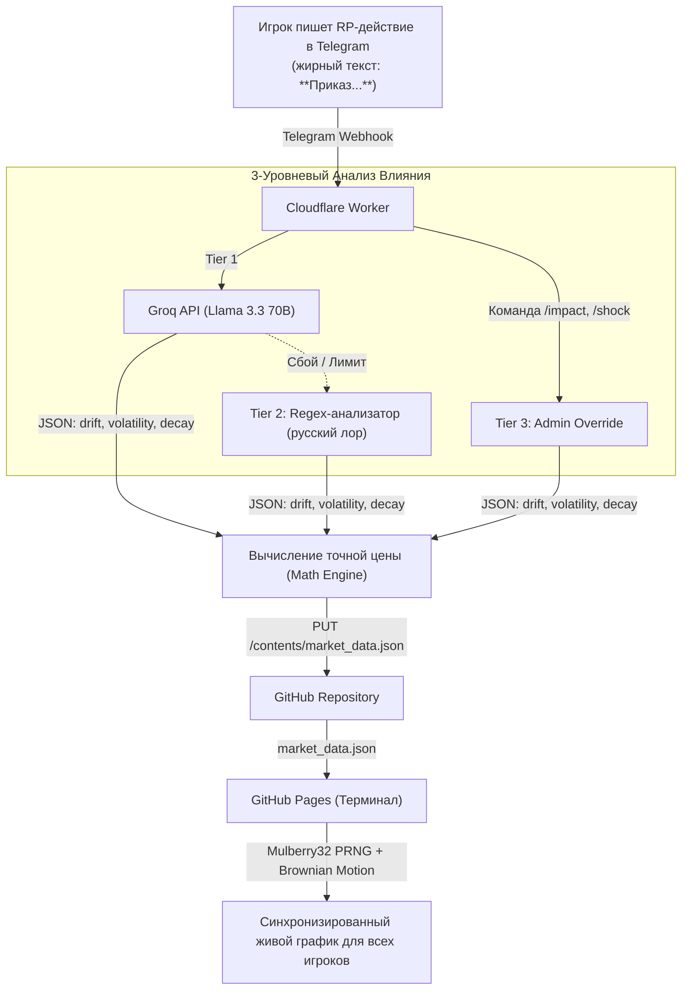

# 🏛️ RYNOK // Межгосударственный Валютный Рынок (RP Exchange)

> **100% Бесплатная ($0 forever), бессмертная и автономная экосистема для геополитической ролевой игры в Telegram.**

Система автоматически слушает посты с RP-действиями в Telegram-канале/чате, оценивает их геополитическое и экономическое влияние на котировки 23 национальных валют через искусственный интеллект (Groq Llama 3.3 70B) или отказоустойчивый Regex-анализатор, коммитит изменения в `market_data.json` через GitHub API и отображает единый интерактивный биржевой терминал на **GitHub Pages**, который выглядит **посекундно на 100% идентично для всех пользователей**.

---

## 🌟 Ключевые особенности и правила лора

1. **Правило Люменарии:** Валюта **«Эфириум» (ETH)** — это **НЕ** реальная криптовалюта. Это официальная суверенная фиатная валюта великого государства **Люменария (Lumenaria)**.
2. **23 Государства:** Полная база стран мира с реальными рейтингами ВВП (от Люменарии с $38.6 трлн до Ферондии с $50 млрд), ВВП на душу, армии, IQ, медицины, образования и счастья.
3. **Бессмертный Zero-Cost стек ($0 без карт и засыпаний):**
   - **Compute:** **Cloudflare Workers** (100 000 бесплатных запросов в сутки, холодный старт 0 мс, не засыпает в отличие от Render/Heroku).
   - **Intelligence:** **GroqCloud API** (модель `llama-3.3-70b-versatile` на бесплатном тарифе) $\to$ при сбое/лимитах автоматический переход на **Deterministic Regex Fallback** на русском языке $\to$ админские команды в Telegram.
   - **Storage:** Репозиторий GitHub (`market_data.json` обновляется напрямую через GitHub REST API).
   - **Frontend:** **GitHub Pages** (TradingView Lightweight Charts, Bloomberg Dark Terminal UI, карточки стран, живой тикер).
4. **Изоморфная детерминированная математика:**
   - График «живет» каждую минуту даже без входящих новостей.
   - Генератор псевдослучайных чисел **Mulberry32** с сидом от `hash(тикер + timestamp_минуты)` в связке с геометрическим броуновским движением (GBM) и затуханием шоков гарантирует, что два игрока в разных точках планеты в одну и ту же секунду видят абсолютно одинаковую цену и одинаковые свечи.
5. **Тихий режим (Stealth Mode):** Бот не спамит карточками в ролевой чат, а молча обрабатывает приказы игроков.

---

## 🏗️ Архитектура системы



---

## 🚀 Быстрый запуск и развертывание

### Шаг 1: Подготовка репозитория GitHub
1. Создайте публичный репозиторий на GitHub (например, `rynok`).
2. Запушьте данный проект в репозиторий:
   ```bash
   git remote add origin https://github.com/ВАШ_ЛОГИН/rynok.git
   git add .
   git commit -m "feat: initial commit of rynok ecosystem"
   git push -u origin main
   ```
3. В настройках репозитория перейдите в **Settings $\to$ Pages**:
   - Source: **Deploy from a branch**
   - Branch: **main** / **(root)**
   - Нажмите **Save**. Через 1 минуту терминал будет доступен по адресу `https://ВАШ_ЛОГИН.github.io/rynok/`.

---

### Шаг 2: Создание токенов доступа

1. **GitHub Personal Access Token (для записи market_data.json):**
   - Перейдите в GitHub: **Settings $\to$ Developer Settings $\to$ Personal access tokens $\to$ Tokens (classic)**.
   - Нажмите **Generate new token (classic)**.
   - Укажите галочку **`repo`** (полный доступ к репозиториям).
   - Скопируйте токен (начинается на `ghp_...`).

2. **GroqCloud API Key (для ИИ-аналитика Llama 3.3 70B):**
   - Зарегистрируйтесь бесплатно на [console.groq.com](https://console.groq.com).
   - Создайте бесплатный ключ в разделе **API Keys** (бесплатный лимит с головой покрывает RP-чат).

3. **Telegram Bot Token:**
   - Создайте бота в Telegram через [@BotFather](https://t.me/BotFather) (`/newbot`).
   - Получите токен бота.
   - Добавьте бота администратором в ваш RP-чат или канал (чтобы он мог читать сообщения).

---

### Шаг 3: Настройка и деплой Cloudflare Worker

1. Откройте файл `worker/wrangler.toml` и укажите ваш логин GitHub и имя репозитория:
   ```toml
   [vars]
   GITHUB_OWNER = "ВАШ_GITHUB_ЛОГИН"
   GITHUB_REPO = "rynok"
   GITHUB_BRANCH = "main"
   ADMIN_USER_IDS = "123456789,987654321" # Ваши Telegram ID через запятую
   MIN_BOLD_LENGTH = "15"
   ```

2. Перейдите в директорию воркера и установите секреты:
   ```bash
   cd worker
   
   # Введите ваш токен GitHub:
   npx wrangler secret put GITHUB_TOKEN
   
   # Введите ваш ключ Groq:
   npx wrangler secret put GROQ_API_KEY
   
   # Введите токен Telegram бота:
   npx wrangler secret put TELEGRAM_BOT_TOKEN
   ```

3. Выполните деплой в Cloudflare (потребуется один раз войти через браузер командой `npx wrangler login`):
   ```bash
   npx wrangler deploy
   ```
   После деплоя Cloudflare выдаст URL вашего воркера, например:  
   `https://rynok-worker.your-subdomain.workers.dev`

---

### Шаг 4: Привязка Telegram Webhook к воркеру

Выполните команду в терминале (или вставьте в адресную строку браузера):

```bash
curl -F "url=https://rynok-worker.ВАШ_SUBDOMAIN.workers.dev" \
  https://api.telegram.org/botВАШ_TELEGRAM_BOT_TOKEN/setWebhook
```

Ответ должен быть: `{"ok":true,"result":true,"description":"Webhook was set"}`.

**Готово!** Теперь система полностью автономна:
- При появлении в чате сообщения с жирным текстом (например: `**Люменария открывает беспошлинный транзит для Гросса**`), воркер перехватывает событие.
- Groq / Regex оценивает влияние и рассчитывает новые параметры тренда и волатильности.
- Воркер коммитит изменения в `market_data.json`.
- График на GitHub Pages автоматически подхватывает событие и на глазах у игроков разворачивает тренд.

---

## 🛠️ Команды администратора (в Telegram)

Администраторы (чьи `user_id` указаны в `ADMIN_USER_IDS`) могут управлять рынком напрямую в чате:

* `/impact <ТИКЕР> <ДРИФТ> [ОПИСАНИЕ]` — принудительно задать импульс валюте.  
  *Пример:* `/impact ETH +0.05 Экономический бум в Люменарии`  
  *Пример:* `/impact VYN -0.07 Военные неудачи Аустры`
* `/shock <ТИКЕР> <ВОЛАТИЛЬНОСТЬ> [ОПИСАНИЕ]` — вызвать всплеск колебаний котировок.  
  *Пример:* `/shock VTN 0.04 Напряжение на границе Критании`

---

## 📊 Таблица стран и валют

| Ранг | Страна | Валюта / Тикер | Базовая цена | Профили |
| :--- | :--- | :--- | :--- | :--- |
| **#1** | **Люменария** | **Эфириум (ETH)** | **250.00** | 🔬 Высокие технологии, ⚙️ Тяжелая промышленность, 🛢️ Сырьевой гигант, 🏦 Финансовый хаб |
| **#2** | **Аустра** | **Вейрон (VYN)** | **180.00** | ⚔️ Военная машина, 🛡️ Плановая автаркия |
| **#3** | **Негеция** | **Нельд (NEL)** | **175.00** | 🔬 Высокие технологии, ⚙️ Тяжелая промышленность, 🏦 Финансовый хаб, 🛢️ Сырьевой гигант |
| **#4** | **Вергилия (ФРВ)** | **Вонга (VNG)** | **95.00** | ⚙️ Тяжелая промышленность |
| **#5** | **Ярландия** | **Ярл (YRL)** | **75.00** | 🔬 Высокие технологии |
| **#6** | **Просперия** | **Тавер (TVR)** | **60.00** | ⚙️ Тяжелая промышленность |
| **#7** | **Гросс** | **Ойл (OIL)** | **55.00** | 🔬 Высокие технологии, ⚙️ Тяжелая промышленность |
| **#8** | **Критания** | **Витан (VTN)** | **45.00** | ⚔️ Военная машина |
| **#9** | **Роха** | **Ровен (RVN)** | **35.00** | 🛢️ Сырьевой гигант, 🌾 Аграрная житница |
| **#10** | **Эшкирия** | **Шакар (SHK)** | **30.00** | 🛢️ Сырьевой гигант, 🌾 Аграрная житница |
| **#11** | **Новая Кайландия** | **Кайрен (KRN)** | **22.00** | ⚙️ Тяжелая промышленность |
| **#12** | **Расшатай** | **Рашен (RSH)** | **18.00** | 🛡️ Плановая автаркия |
| **#13** | **Фертенберг** | **Фертмарка (FRT)** | **16.00** | 🌾 Аграрная житница, ⚙️ Тяжелая промышленность |
| **#14** | **Мантия** | **Вельт (VLT)** | **32.00** | 🏦 Финансовый хаб |
| **#15** | **Этрория** | **Этвейн (ETW)** | **40.00** | 🏦 Финансовый хаб |
| **#16** | **Асмаин** | **Азмар (AZM)** | **12.00** | 🔬 Высокие технологии, 🛢️ Сырьевой гигант |
| **#17** | **Хисолия** | **Хисолийская крона (HRN)** | **10.00** | ⚙️ Тяжелая промышленность |
| **#18** | **Урия** | **Урийский нельд (URE)** | **25.00** | 🌾 Аграрная житница, 🏦 Финансовый хаб |
| **#19** | **Гайяна** | **Омай (OMY)** | **4.50** | 🛡️ Плановая автаркия |
| **#20** | **Пагристан** | **Тангар (TGR)** | **3.00** | 🛡️ Плановая автаркия |
| **#21** | **Северный Сапах** | **Северный велар (NVR)** | **5.50** | ⚙️ Тяжелая промышленность |
| **#22** | **Южный Сапах** | **Южный велар (SVR)** | **5.00** | ⚙️ Тяжелая промышленность |
| **#23** | **Ферондия** | **Ферзак (FRZ)** | **8.50** | 🌾 Аграрная житница |
